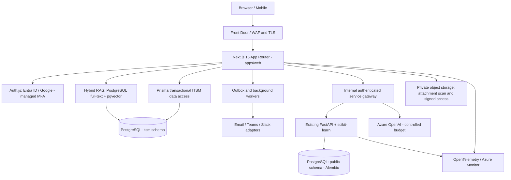
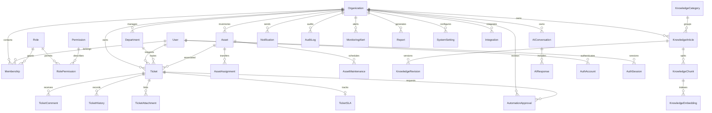
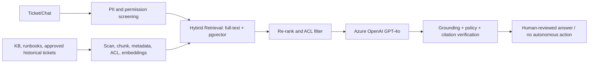
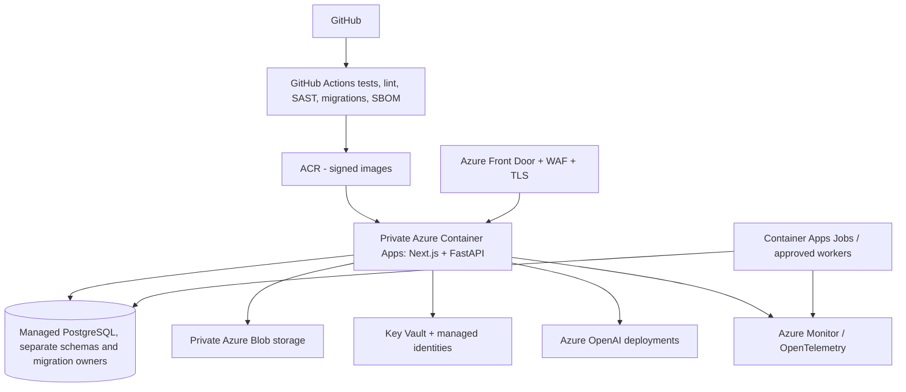

# IT-AI-Copilot — Enterprise Architecture (ADR-0001)

**Status:** Approved as implementation baseline (proposed, not certified production-ready).  
**Existing:** Python FastAPI, scikit-learn, OIDC JWT verification, Alembic and PostgreSQL in repository `main`.  
**Target:** 1,000+ organization users after load tests, resilience validation, penetration review and operating procedures.

## 1. Bounded contexts and system architecture



- **Single repo; distinct services and migration owners**. Next.js owns ITSM/identity tables in PostgreSQL schema `itsm` through Prisma migrations. Python/Alembic owns only its existing `public` schema. No cross-ORM writes to the other schema. A future internal integration uses OIDC client credentials or workload identity with strict scopes and network controls, not an exposed secret in the browser.
- **Next.js Route Handlers and Server Actions** coordinate UI/workflow. Mutations enforce identity, organization membership, permission, validation and idempotency on the server, never only middleware. Route handlers expose versioned JSON APIs.
- **Background jobs** handle notification delivery, SLA escalation, report generation, ingestion, embedding and scheduled monitoring. User requests never synchronously run diagnostic scripts.
- **React Query** for interactive server state, **Zustand** for ephemeral UI state only. Server Components for initial dashboard reads, Shadcn-style accessible UI primitives for controls; React Hook Form + Zod for input validation.
- Keep user-selected Next.js 15 pinned initially; validate compatible supported security patch releases before publicly deploying. Avoid assuming legacy packages remain secure without updates.

## 2. Database ERD — ITSM schema



All tenant-owned rows carry `organizationId`, consistent UUID IDs, createdAt/updatedAt and nullable deletedAt where relevant. Composite indexes include organizationId first. **Tenant IDs are determined from the authenticated session and verified membership**, not accepted from untrusted payloads. For attachments, store metadata only in PostgreSQL and blobs in private object storage. JSON metadata must never hold credentials.

**Migration ownership:** Prisma `@@schema("itsm")` for web app entities. pgvector types require hand-written SQL migrations / raw SQL; do not pretend Prisma handles pgvector vectors natively. SQL `SET LOCAL` / PostgreSQL RLS are optional defense-in-depth after explicit RLS design and connection-pool testing. Never mix Python migrations with Prisma table ownership.

## 3. API contract (v1)

All endpoints require authenticated session and organization authorization; user roles checked per operation. Pagination: `limit` (1..100) and opaque `cursor`, stable order by createdAt/id. Filter/sort allowlisted server-side, never raw SQL. `application/problem+json` errors with requestId, safe message and status. Mutation responses may accept `Idempotency-Key`.

| Resource | Methods and URLs | Permission |
|---|---|---|
| Auth | `GET/POST /api/auth/[...nextauth]` | Auth.js |
| Identity | `GET /api/v1/me`, `GET /api/v1/organizations` | signed-in |
| Users & roles | `GET/POST /api/v1/users`, `PATCH /api/v1/users/:id` | users.manage |
| Tickets | `GET/POST /api/v1/tickets`, `GET/PATCH /api/v1/tickets/:id` | tickets.read / tickets.create / tickets.update |
| Tickets | `POST /api/v1/tickets/:id/assign`, `/comments`, `/close` | tickets.assign / tickets.comment / tickets.close |
| Assets | `GET/POST /api/v1/assets`, `GET/PATCH /api/v1/assets/:id` | assets.read / assets.manage |
| Knowledge | `GET/POST /api/v1/knowledge`, `GET/PATCH /api/v1/knowledge/:id`, `POST /:id/publish` | knowledge.read / knowledge.manage |
| AI | `POST /api/v1/ai/chat`, `GET /api/v1/ai/conversations` | ai.use |
| Monitoring | `GET /api/v1/alerts`, `POST /api/v1/integrations/:id/events` | alerts.read / integrations.manage |
| Metrics | `GET /api/v1/analytics/overview`, `/trends`, `/sla` | reports.view |
| Notifications | `GET /api/v1/notifications`, `PATCH /:id/read` | signed-in |
| Admin | `GET/PATCH /api/v1/settings`, `/sla-rules`, `/departments` | settings.manage |
| Automation | `POST /api/v1/automations/requests`, `POST /:id/approve` | automation.request / automation.approve |

For the first web PR, only `/api/v1/me`, `/api/v1/tickets` and `/api/v1/analytics/overview` are implemented; remaining URLs are contracts, not completed endpoints.

## 4. RBAC matrix

Roles are **per organization**, not global. Tickets additionally enforce requester/assignee visibility policy where required. A different, authorized individual must approve automation. Superusers are not implicit.

| Operation | Admin | IT Manager | Technician | Employee | ReadOnly Auditor |
|---|---|---|---|---|---|
| Create ticket | Yes | Yes | Yes | Yes | No |
| Read tickets | Yes | Yes | Assigned/team | Own | Audit-scoped |
| Assign / reassign | Yes | Yes | No | No | No |
| Close ticket | Yes | Yes | Assigned | Own resolved with policy | No |
| Manage users/roles | Yes | No | No | No | No |
| View operational reports | Yes | Yes | Team | No | Yes |
| Manage assets | Yes | Yes | Assigned inventory | No | No |
| Use AI | Yes | Yes | Yes | Limited | No |
| Manage knowledge | Yes | Yes | Draft | No | No |
| Configure integrations | Yes | No | No | No | No |
| Approve automation | Yes (not requester) | Yes (if delegated) | No | No | No |

Enforce granular `Permission` records and organization membership on every mutation and read; the table documents policy intent, not an automatic grant.

## 5. Component hierarchy & navigation

```text
app/
  (auth)/sign-in/page.tsx
  (platform)/layout.tsx
  (platform)/dashboard/page.tsx
  (platform)/tickets/page.tsx
  (platform)/tickets/[id]/page.tsx
  (platform)/assets/page.tsx
  (platform)/knowledge/page.tsx
  (platform)/copilot/page.tsx
  (platform)/monitoring/page.tsx
  (platform)/reports/page.tsx
  (platform)/admin/page.tsx
components/ui/*                 # accessible Shadcn components
components/shell/*              # nav, topbar, org switcher, theme
features/tickets/*             # form, filters, table, SLA badge, timeline
features/copilot/*             # assistant chat, citations, diagnostic steps
features/dashboard/*           # accessible KPI cards, Recharts, filters
features/assets/*              # inventory, history, assignment
features/knowledge/*           # article editor, revisions, approval
providers/*                    # QueryClient, theme, Auth provider
lib/auth/*                     # Auth.js session and membership checks
lib/db/*                       # Prisma, tenant scoped DAL
lib/ai/*                       # service-to-service inference and RAG
lib/permissions/*              # permission enforcement
```

UI requirements: responsive mobile/tablet/desktop, WCAG 2.2 AA verification, keyboard navigation, accessible charts, 44px mobile touch targets, light/dark, reduced-motion support, skeleton/empty/error states. Glass effect only sparingly for noninteractive decoration.

## 6. AI / RAG architecture



Each chunk stores tenant ID, source ACL, checksum, version, model/embedding version and citation locator. Re-check ACL before and after retrieval. Treat all retrieved text as untrusted. Limit context, redact secrets, do not provide unsupported root cause, and show when evidence is insufficient. AI suggestions never directly trigger scripts. Log token usage, feedback and prompt/model versions without retaining secrets. Evaluate retrieval recall and hallucination/citation accuracy with permissioned test cases. Use local TF-IDF fallback until Azure/OpenAI/pgvector provisioned; no false claims of semantic search.

## 7. Infrastructure, deployment, and reliability



Deployment sequence: PR checks → preview/staging → secret/DB readiness → one-off migration job → canary web/api release → smoke tests → promote → rollback application (DB roll-forward). Avoid executing migrations concurrently in every web replica. CI needs integration tests on PostgreSQL, contract tests for Python, authorization and tenant crossover, accessibility checks, load tests (target >=1,000 users before claiming readiness), backup restore drill, threat model and retention enforcement. Queue worker and outbox enforce retry/ordering. Use SSE initially for ticket updates; WebSockets only if measured needs require it.

## 8. Security threat model

- **Authentication:** Entra ID / Google via Auth.js with provider-managed MFA. Credential login, reset, refresh rotation, TOTP/WebAuthn and lockout are **separate security epics**, not a fake simple credentials-provider toggle. Do not ship password flows without hardened storage, anti-enumeration, breached-password checks and recovery policies.
- **Session:** HttpOnly, Secure, SameSite cookies; rotate secrets; persistent DB adapter for revocation; re-auth for high-risk actions; explicit session expiry.
- **Authorization:** Fail closed, no cross-tenant queries, deny-by-default permissions, membership verified from DB each request, resource-level checks. Middleware redirects are UX only.
- **CSRF:** Auth.js controls on sign-in; mutation routes require same-origin protections and/or strict Origin verification; Server Actions require authorization and validation.
- **XSS/SQL injection:** Escape text, disallow unsafe HTML, Zod validation, Prisma parameterization and allowlisted sort/filter, sanitization for rich-text articles.
- **Attachments:** Private bucket, MIME sniffing, antivirus scanning, quotas, one-time signed upload, path isolation, no public blobs.
- **Secrets:** Key Vault, managed identities, no client-side API keys; encrypt sensitive data at rest and transit.
- **Audit:** Append-only events with subject, organization, timestamp, requestId, action and outcome; external retention/integrity controls for regulated use.
- **Automation:** Distinct requester and approver by verified subject, scoped role, least-privileged runner, dry-run, limits, evidence, idempotency, rollback and human kill switch.
- **Availability:** per-tenant rate limits, request size caps, bounded queues, database pool limits, graceful degradation when AI unavailable.
- **External monitoring webhook:** verify signature, anti-replay window, deduplicate event ID, map integration to tenant, never accept org ID in payload as authority.

## 9. Phased implementation with acceptance gates

1. **Phase 5A (this PR):** Architecture, ITSM Prisma schema/ERD, Next.js 15 scaffold, OAuth configuration, basic authenticated tickets and dashboard shell, typed API contracts, Docker/web CI. No public deployment or production claim.
2. **Phase 5B:** Database migrations in staging, organization provisioning, complete RBAC, forms, attachment policy, SLA/ticket lifecycle and comprehensive E2E tests.
3. **Phase 6:** Assets, maintenance, knowledge revisions and approval, notifications, admin settings, search, monitoring ingestion.
4. **Phase 7:** Azure OpenAI + pgvector RAG ingestion, evaluations, cost quotas, grounded chat and service-to-service Python model gateway.
5. **Phase 8:** Reports/exports, jobs, WebSocket/SSE measured need, audit integrity, operational dashboards and safe automation.
6. **Phase 9:** Pen testing, DR/backup drills, WCAG audit, >=1,000-user realistic load test, on-call/runbooks, multi-tenant pilot and billing.

**Release gate:** successful CI is necessary but not sufficient. Never label the system enterprise/production ready before hardening and independently verified tests.

## 10. Cost guardrails for a $200 Azure startup credit

No paid resources created by this PR. Local development: Docker PostgreSQL, Python API, Next.js. Staging: one low-cost Container App per necessary service, scale-to-zero when possible, limited retention and strict token quotas. Azure budget alerts are not hard caps. Defer managed monitoring clusters, Pinecone, dedicated Redis, production Azure PostgreSQL and GPT-4o calls until justified. Keep low-cost `pgvector` in PostgreSQL for first RAG MVP.
